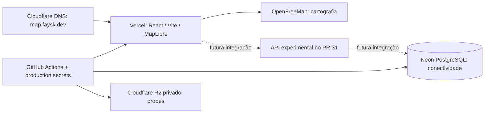

# World Pulse 🌍

Um planeta cinza que ganha cores com a participação das pessoas.

**Estado em 24/10/2026:** [demonstração visual publicada](https://map.faysk.dev), com dados simulados. A infraestrutura está provisionada; a aplicação ainda não grava participação real no banco de produção.

## Estrutura real

| Parte | Tecnologia / serviço | Estado |
| --- | --- | --- |
| Interface | React 19 + TypeScript + Vite | Publicada na Vercel |
| Globo | MapLibre GL + cartografia OpenFreeMap | Publicado; participantes sintéticos |
| Hospedagem | Vercel Hobby, projeto `world-pulse` | HTTPS em `map.faysk.dev` |
| Banco | Neon Free / PostgreSQL, Londres | Conectividade TLS e acesso SQL restrito verificados |
| DNS | Cloudflare, zona `faysk.dev` | `map` aponta à Vercel, DNS only |
| Objetos | Cloudflare R2, bucket privado `world-pulse-production` | Provisionado; ainda sem função no fluxo de taps |
| Configuração e entrega | GitHub Actions + Environments `production` e `staging` | Origem das secrets/configurações e deploy manual de `main` |
| Steam LIVE | `GET /api/steam` · Steam Web API oficial | **Oculto na interface de produção**, código e endpoint preservados para desenvolvimento |
| API de participação | [PR #31](https://github.com/Faysk/world-pulse/pull/31) | Draft, gate desligado em produção; PostgreSQL descartável e branch Neon staging isolada |

Não há serviço de autenticação externo, conexão direta do browser ao banco ou bucket público. Nenhum outro banco de outro projeto foi removido ou alterado.



Linhas pontilhadas representam o fluxo público ainda não ativado; o laboratório experimental já usa banco descartável no CI. O Neon staging remoto é uma branch separada, temporária, com expiração em 31/10/2026. [Staging](docs/18-remote-staging.md). Veja [arquitetura](docs/05-free-tier-architecture.md) e [operações](docs/11-infrastructure-operations.md).

O feed da Steam foi mantido no código, mas o painel foi **ocultado da experiência pública** por não ser parte do conceito central do World Pulse. Não há consultas Steam feitas pela interface enquanto estiver oculto. [Decisão e documentação da integração](docs/16-steam-live-signals.md).

## Regras do produto

- Cada tap elegível adiciona **+1 segundo de saldo** à hashtag selecionada e ao histórico creditado.
- O saldo diminui com o relógio real, inclusive offline. Histórico e saldo restante são métricas diferentes.
- Várias hashtags podem manter saldo/manchas simultaneamente; novos taps vão para uma seleção de cada vez.
- A densidade conta participantes distintos por hashtag com saldo positivo, nunca soma de taps ou segundos.
- Cor aleatória é persistida na primeira criação da hashtag; criação real ainda depende da API.
- Localização será aproximada e agregada; não publicar posição individual.
- Top 10 atual conta participações com saldo positivo; ao zerar, sai do ranking e da mancha. Histórico começa na seleção e fica separado. [Contrato](docs/24-ranking-contract.md).

A POC publicada ainda possui contador local por sessão; não confundir esse teste com saldo persistido em produção. [Contrato confirmado](docs/14-time-credit-contract.md).

## Experiência integrada em homologação

Na branch experimental da API, `/?experiencePreview=1` em desenvolvimento abre
o fluxo de hashtags livres, taps no planeta, fila confirmada, saldos simultâneos
e ranking atual. O mapa não recebe população sintética nesse modo: aguarda
geografia confiável. Build remoto exige preview explicitamente autorizado;
parâmetro de URL não ativa a experiência em produção.
[Interface, gates e evidências](docs/29-live-experience.md).

## Executar e verificar

Node compatível com `package.json` (CI visual usa Node 22; infraestrutura usa Node 24):

```sh
npm ci
npm run dev
npm run check
npx playwright install chromium
npm run test:browser
npm ci --prefix infra --ignore-scripts
npm test --prefix infra
```

O app visual não exige secrets. Nunca colocar credenciais em `VITE_*` nem versionar `.env.local`.

## Organização do repositório

```text
src/                         interface, globo, datasets sintéticos e contrato de saldo
tests/                      testes de domínio e navegador
infra/                       probes Neon/R2, sincronização e publicação staged
infra/sql/                   migrações 0001–0006; domínio aplicado/verificado no staging
scripts/                     benchmark dos cenários agregados
api/steam.mjs                endpoint do feed externo Steam
server/steam.mjs             consulta/validação do feed externo
server/geoPrivacy.mjs       país aproximado fechado por padrão; API draft agrega com consentimento
.github/workflows/           validação, produção manual e organização de milestones
docs/                        arquitetura, regras, evidências e pendências
```

As pastas `api/` e `server/` contêm a API de participação e o feed Steam preservado e oculto. O pacote do [PR #31](https://github.com/Faysk/world-pulse/pull/31) reúne sessões, filas, saldos, ranking e geografia por país; as migrações 0001–0006 foram aplicadas/verificadas no staging. Produção mantém a demonstração, sem migrações de domínio/ativação da API realizadas nesta etapa. Código na main não equivale a publicação: flags e fluxo de deploy continuam fechados.

## Documentação e próximos passos

- **[Estado verificado antes da publicação](docs/36-prepublication-status.md)** · [HTTPS privado e Neon real](docs/35-staging-private-https-smoke.md)

- [Prontidão e estrutura real da API](docs/26-readiness.md) · [Retenção aprovada](docs/27-retention-policy.md) · [Benchmark CPU completo](docs/28-population-benchmark.md)
- [Fila entre abas](docs/23-cross-tab-queue.md) · [Ranking atual/histórico](docs/24-ranking-contract.md) · [Orçamento de operações](docs/25-api-operation-budgets.md)

- [Visão e escopo](docs/01-vision-and-scope.md) · [Interação](docs/02-interaction-rules.md)
- [Arquitetura implantada](docs/05-free-tier-architecture.md) · [Modelo de domínio](docs/06-data-model.md)
- [Roadmap atual](docs/07-roadmap.md) · [Decisões abertas](docs/08-open-questions.md)
- [Milestones e entregas](docs/10-milestones-and-progress.md) · [Runbook de produção](docs/11-infrastructure-operations.md)
- [Revisão crítica atual](docs/12-project-review.md) · [Primeira publicação visual](docs/13-visual-release-v0.1.md)
- [Saldo cronológico](docs/14-time-credit-contract.md) · [Cenários de 0 a 8 bilhões e 1 trilhão](docs/15-population-scenarios.md)
- [Steam LIVE — integração oculta](docs/16-steam-live-signals.md) · [Issue #40](https://github.com/Faysk/world-pulse/issues/40)
- [Gestos e +1 segundo sem falsos cliques](docs/17-gesture-safety.md) · [Agregação espacial por zoom e benchmarks](docs/18-spatial-aggregation-spike.md)
- [Privacidade geográfica (protótipo isolado)](docs/20-geo-privacy-country-poc.md) · [Prévia de ranking ativo (branch da API)](https://github.com/Faysk/world-pulse/blob/feat/real-participation-api/docs/19-active-balance-ranking.md)
- [Compositor WebGL2 por célula](docs/25-overlap-compositor-spike.md) · [Atlas instanciado de 256 regiões](docs/26-multicell-webgl-atlas.md) · [Laboratório DEV-only](experiments/overlap-atlas.html)
- [Atlas geográfico por viewport (Mercator 2D)](docs/27-geographic-viewport-atlas.md) · [Laboratório de projeção](experiments/geographic-atlas.html) · [PR #69](https://github.com/Faysk/world-pulse/pull/69)

O reconhecimento de gestos do globo foi reforçado no [PR #47](https://github.com/Faysk/world-pulse/pull/47), integrado em `main`. A agregação de células por zoom e seu benchmark entraram como módulo **não ligado ao renderer** no [PR #49](https://github.com/Faysk/world-pulse/pull/49); o compositor experimental por célula ([PR #63](https://github.com/Faysk/world-pulse/pull/63)) e o atlas WebGL2 para até 256 regiões em um draw ([PR #66](https://github.com/Faysk/world-pulse/pull/66)) estão na `main` como **pesquisa isolada**, sem ligação ao renderer público. O [PR #69](https://github.com/Faysk/world-pulse/pull/69) adicionou projeção **Mercator 2D com zoom/antimeridiano e paginação de viewport** (620 células sintéticas em 3 draws), ainda **sem integrar ao globo público**. Projeção esférica MapLibre, privacidade, visual orgânico, fallback e FPS físico continuam na [issue #32](https://github.com/Faysk/world-pulse/issues/32).

O fluxo **interface → HTTPS privado no Actions → pooler Neon staging real → dois navegadores** passou em [40061344573](https://github.com/Faysk/world-pulse/actions/runs/40061344573), sem Vercel/deploy. Sessões independentes, cookies seguros, saldos, retorno, perda de resposta/retry e consentimento persistido foram conferidos; a borda pública ainda precisa de homologação. [Países multicolor com foco opcional e busca](docs/38-multicolor-countries.md) aparecem sem pontos individuais; a fonte geográfica está desligada até ser verificada. CPU/BigInt podem representar contagens enormes, mas não comprovam bilhões de conexões ou FPS físico.

[Issues](https://github.com/Faysk/world-pulse/issues) · [Milestones](https://github.com/Faysk/world-pulse/milestones) · Licença [MIT](LICENSE).

[Geografia por país com consentimento e limites reais](docs/31-country-geography.md): implementação na branch da API, sem ativação pública.

[Operações finais: preview, retenção e ativação explícita da alpha](docs/32-prepublication-operations.md), com gates fechados e publicação pausada.
