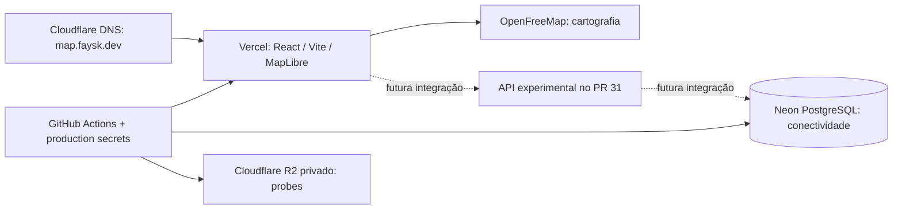

# World Pulse 🌍

Um planeta cinza que ganha cores com a participação das pessoas.

**Estado em 24/10/2026:** [demonstração visual publicada](https://map.faysk.dev), com dados simulados. A infraestrutura está provisionada; a aplicação ainda não grava participação real no banco de produção.

## Estrutura real

| Parte | Tecnologia / serviço | Estado |
| --- | --- | --- |
| Interface | React 19 + TypeScript + Vite | Publicada na Vercel |
| Globo | MapLibre GL + cartografia OpenFreeMap | Publicado; participantes sintéticos |
| Hospedagem | Vercel Hobby, projeto `world-pulse` | HTTPS em `map.faysk.dev` |
| Banco | Neon Free / PostgreSQL, Londres | Conectividade TLS e acesso SQL restrito verificados |
| DNS | Cloudflare, zona `faysk.dev` | `map` aponta à Vercel, DNS only |
| Objetos | Cloudflare R2, bucket privado `world-pulse-production` | Provisionado; ainda sem função no fluxo de taps |
| Configuração e entrega | GitHub Actions + Environment `production` | Origem das secrets/configurações e deploy manual de `main` |
| API de participação | [PR #31](https://github.com/Faysk/world-pulse/pull/31) | Draft, gate desligado, migração de domínio não aplicada |
| Feed externo Steam | `api/steam.mjs` → API pública Steam | Integrado em `main` pelo PR #41; separado dos participantes/manchas |

Não há serviço de autenticação externo, conexão direta do browser ao banco ou bucket público. Nenhum outro banco de outro projeto foi removido ou alterado.



Linhas pontilhadas representam trabalho ainda não ativado. Veja [arquitetura](docs/05-free-tier-architecture.md) e [operações](docs/11-infrastructure-operations.md).

O feed Steam consulta uma amostra de jogos, sem banco ou chave de API, e não representa participantes do World Pulse nem localização. Seu código chegou a `main` depois do último deploy confirmado nesta revisão ([40041911767](https://github.com/Faysk/world-pulse/actions/runs/40041911767)); presença em `main` não é evidência de publicação. [Escopo do feed](docs/15-steam-live-signals.md).

## Regras do produto

- Cada tap elegível adiciona **+1 segundo de saldo** à hashtag selecionada e ao histórico creditado.
- O saldo diminui com o relógio real, inclusive offline. Histórico e saldo restante são métricas diferentes.
- Várias hashtags podem manter saldo/manchas simultaneamente; novos taps vão para uma seleção de cada vez.
- A densidade conta participantes distintos por hashtag com saldo positivo, nunca soma de taps ou segundos.
- Cor aleatória é persistida na primeira criação da hashtag; criação real ainda depende da API.
- Localização será aproximada e agregada; não publicar posição individual.
- Ordenação do Top 10 permanece aberta na [issue #8](https://github.com/Faysk/world-pulse/issues/8).

A POC publicada ainda possui contador local por sessão; não confundir esse teste com saldo persistido em produção. [Contrato confirmado](docs/14-time-credit-contract.md).

## Executar e verificar

Node compatível com `package.json` (CI visual usa Node 22; infraestrutura usa Node 24):

```sh
npm ci
npm run dev
npm run check
npx playwright install chromium
npm run test:browser
npm ci --prefix infra --ignore-scripts
npm test --prefix infra
```

O app visual não exige secrets. Nunca colocar credenciais em `VITE_*` nem versionar `.env.local`.

## Organização do repositório

```text
src/                         interface, globo, datasets sintéticos e contrato de saldo
tests/                      testes de domínio e navegador
infra/                       probes Neon/R2, sincronização e publicação staged
infra/sql/0001-runtime-access.sql  baseline de acesso SQL; não é schema da aplicação
scripts/                     benchmark dos cenários agregados
api/steam.mjs                endpoint do feed externo Steam
server/steam.mjs             consulta/validação do feed externo
.github/workflows/           validação, produção manual e organização de milestones
docs/                        arquitetura, regras, evidências e pendências
```

Os demais endpoints de participação, `server/store.mjs`, `server/handlers.mjs`, o cliente `participationClient.ts` e as migrações `0002`/`0003` estão **somente no PR #31** enquanto ele permanecer em draft. A correção de saldo e retries foi integrada nesse draft pelo [PR #43](https://github.com/Faysk/world-pulse/pull/43), com testes em PostgreSQL descartável; isso ainda não ativa participação em produção.

## Documentação e próximos passos

- [Visão e escopo](docs/01-vision-and-scope.md) · [Interação](docs/02-interaction-rules.md)
- [Arquitetura implantada](docs/05-free-tier-architecture.md) · [Modelo de domínio](docs/06-data-model.md)
- [Roadmap atual](docs/07-roadmap.md) · [Decisões abertas](docs/08-open-questions.md)
- [Milestones e entregas](docs/10-milestones-and-progress.md) · [Runbook de produção](docs/11-infrastructure-operations.md)
- [Revisão crítica atual](docs/12-project-review.md) · [Primeira publicação visual](docs/13-visual-release-v0.1.md)
- [Saldo cronológico](docs/14-time-credit-contract.md) · [Cenários de 0 a 8 bilhões e 1 trilhão](docs/15-population-scenarios.md)

Próxima entrega: revisar a API, alinhar banco e respostas ao saldo cronológico, validar em banco descartável e integrar dois navegadores. Geografia pública, retenção, abuso e ranking exigem trabalho próprio antes da alpha. O laboratório suporta até 756 células sintéticas; isso não comprova capacidade de atender bilhões de usuários reais.

[Issues](https://github.com/Faysk/world-pulse/issues) · [Milestones](https://github.com/Faysk/world-pulse/milestones) · Licença [MIT](LICENSE).
