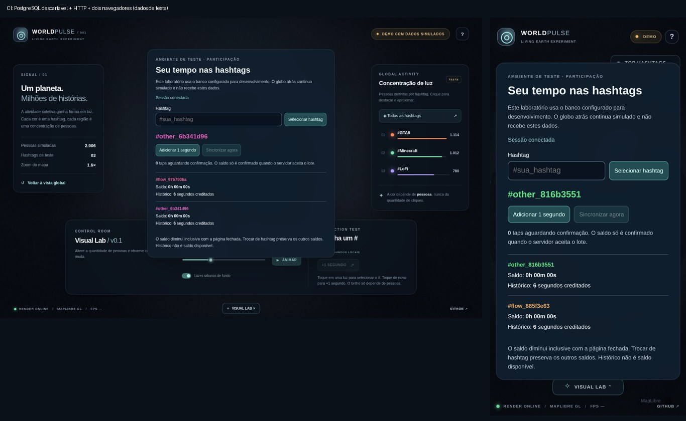

# 17 — Participação ponta a ponta em ambiente isolado

Rastreio: #48, #20, #4, #5 e #13. Implementação dentro do draft #31; não é lançamento da participação pública.

## Ambiente escolhido

PostgreSQL 16 descartável no serviço do GitHub Actions, sem Neon, R2, DNS ou
production secrets. Cada job recebe um banco novo. O teste aplica `0001`, `0002`
e `0003` como proprietário local, encerra essa conexão e atende às requisições
com a role restrita `world_pulse_app`. Não cria tabelas em produção.

O harness `scripts/isolated-participation.mjs` aceita somente opt-in explícito,
recusa `DATABASE_URL`/`DATABASE_MIGRATION_URL` e tem host, banco e credenciais de
teste fixados em loopback (`world_pulse_ci`, `local-only`). Publica o servidor
de desenvolvimento apenas em `127.0.0.1:4174`. Não é um servidor de produção.
HTTP/cookie sem Secure são exclusivos desse processo de desenvolvimento local;
o handler de produção mantém HTTPS, Secure e gate desligado.

Isso é um ambiente efêmero de integração no CI, **não um deployment de staging
persistente na nuvem**. Não promete disponibilidade externa nem substitui testar
um ambiente Vercel isolado antes da ativação real.

## Interface e separação dos dados

Abrir `http://127.0.0.1:4174/?participationPreview=1` no servidor isolado.
O laboratório só é montado em desenvolvimento por essa opção explícita;
parâmetros da URL não habilitam a interface no build de produção.

- Criar/resgatar hashtag com cor persistente e selecionar para novos taps.
- Acumular taps e sincronizar em lotes aproximadamente a cada dois segundos
  enquanto a página estiver visível; também há sincronização manual.
- Separar taps pendentes, saldo confirmado e histórico creditado.
- Contar saldo por relógio monotônico desde o snapshot de cada hashtag;
  sincronizar outra hashtag não reinicia o relógio das anteriores.
- Restaurar seleção, nomes, cores e saldos da sessão pelo servidor ao retornar.
- Em falha, preservar a fila e exigir retry deliberado, sem bombardear a API.

O globo continua sintético e o aviso permanece visível. Nenhuma contagem do
laboratório alimenta manchas, geografia ou ranking público. O cliente não
recebe credenciais de banco e o painel Steam permanece oculto.

O saldo é confirmado no instante em que o servidor aceita o lote, não retroage
ao relógio declarado pelo cliente. Taps ainda não sincronizados não são saldo
durável confirmado. Janela de lotes atrasados/retenção e tratamento de sessão
expirada precisam de política antes de produção. A fila pode ser perdida se o
usuário apagar o armazenamento do navegador.

## Testes

`Participation API CI` tem dois jobs independentes:

1. Contratos e transações PostgreSQL: migração, grants, concorrência, saldo,
   idempotência e isolamento de sessões.
2. Dois contextos de navegador reais, repetidos em desktop e celular emulado:
   interface → HTTP com cookie → handler → PostgreSQL → resposta → interface.

O segundo job verifica mesma hashtag/cor em duas sessões, históricos separados,
troca de hashtag, restauração e saldo expirado. Para simular perda de resposta,
o teste deixa a requisição concluir no banco e descarta a resposta; em seguida
adiciona outro tap e reenvia. O histórico no PostgreSQL deve refletir ambos uma
única vez. A expiração de teste é manipulada somente no banco descartável para
evitar sleeps longos.

A cartografia é substituída por estilo mínimo local nos testes de navegador;
os handlers e o banco desse job não são mocks. Capturas/traces ficam no artefato
`world-pulse-participation-isolated` por sete dias.

`tests/browser/participation-preview.spec.ts` é **outro** teste, com API simulada,
para revisar layout e eventos localmente. Não usar suas capturas como prova de
persistência. `tests/client.test.mjs` verifica relógios independentes e reenvio;
`tests/isolation.test.mjs` verifica a recusa de variáveis de banco de produção.

## Reproduzir localmente

Requer PostgreSQL **exclusivo de teste**, não um banco de trabalho existente.
Uma opção descartável, sem volume persistente, caso Docker esteja instalado:

```powershell
docker run --rm --name world-pulse-isolated -e POSTGRES_PASSWORD=local-only -e POSTGRES_DB=world_pulse_ci -p 127.0.0.1:5432:5432 postgres:16
```

Em outro terminal, sem variáveis de banco de produção:

```powershell
npm ci
npx playwright install chromium
$env:WP_ISOLATED_TEST='1'
npm run test:participation
```

Para explorar manualmente no mesmo banco descartável:

```powershell
$env:WP_ISOLATED_TEST='1'
node scripts/isolated-participation.mjs
```

Não há PostgreSQL/Docker instalado na máquina usada nesta revisão; o caminho
com banco real é executado pelo CI. Isso não autoriza instalar um banco de
produção local nem puxar credenciais do Neon para este teste.

## Evidência de execução — 24/10/2026

[Participation API CI 40046758612](https://github.com/Faysk/world-pulse/actions/runs/40046758612):
job de transações PostgreSQL aprovado e job de dois navegadores aprovado, com
dois testes concluídos em desktop/celular emulado. Cada teste usa duas sessões
independentes e verifica também os registros no banco, inclusive após perder
a resposta de uma transação já confirmada.



As identidades/hashtags nas capturas são dados de teste, não usuários públicos.
O banco é real e descartável; o mapa de fundo é o estilo mínimo de teste.

O preview remoto deste PR foi recusado pela Vercel com `build-rate-limit` e
orientação de aguardar 24 horas. Nenhum upgrade foi feito. O CI e a validação
isolada concluíram independentemente; staging remoto continua pendente.

Atualização: o [banco do staging remoto](18-remote-staging.md) já foi preparado
e verificado pelo Actions. A interface/API pelo preview HTTPS ainda está
pendente; isso não altera o escopo descartável das evidências desta página.

## Antes de produção

Validar staging Vercel/Neon isolado, integrar a UX definitiva, resolver retenção,
limites globais de abuso/custo, identificação anônima e aviso de privacidade.
Geografia pública (#6), ranking final (#8) e resolução de manchas (#32) continuam
etapas próprias. Não ativar `WP_API_ENABLED` por causa de um teste verde.
