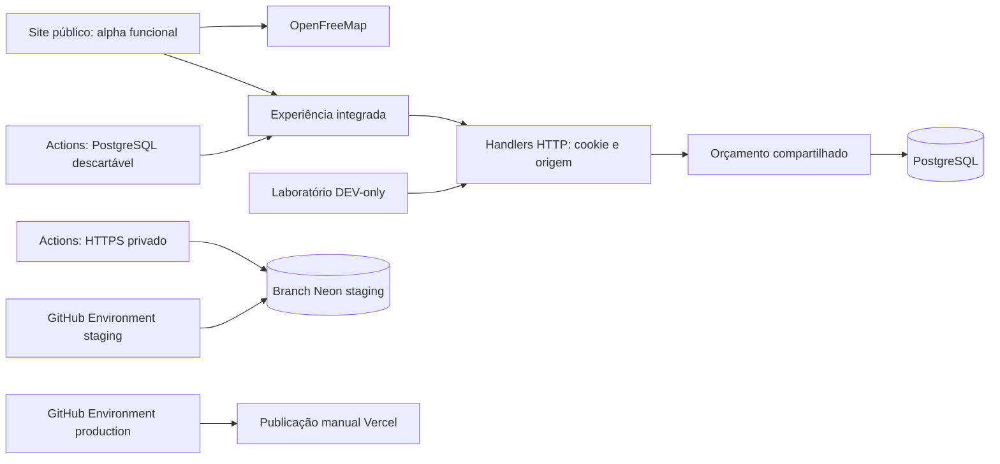

# 26 — Estrutura real e prontidão da participação

Atualizado em 26/10/2026. Alpha/API de produção foram deliberadamente ativadas
pelo Actions; fonte direta de país foi verificada e ativada. Código na main não publica
automaticamente. [Estado operacional atual](42-regional-participation-points.md).

## Caminhos reais

O browser não recebe conexão SQL, token Vercel ou chave R2. R2 é privado e não
participa do fluxo de taps; não há motivo atual para enviar cada clique para
objetos. O feed Steam permanece no código e oculto da experiência pública.

## Tabelas do código experimental

| Tabela em `world_pulse` | Função |
|---|---|
| `tags` | Nome normalizado único e cor persistida uma vez |
| `visitors` | Hash do cookie, seleção, retorno/validade, país opcional e célula regional autorizada |
| `visitor_tags` | Par único sessão/hashtag, histórico de segundos e expiração do saldo |
| `tap_batches` | ID/fingerprint e taps de cada lote para idempotência |
| `operation_budgets` | Até cinco contadores compartilhados de capacidade, sem dados de localização |
| `tag_history_totals` | Histórico consolidado por hashtag sem vínculo individual |
| `country_snapshot_cache` | Uma linha de resumo por país por janela de 5s, sem IDs individuais |
| `region_snapshot_cache` | Agregado por célula/hashtag com saldo positivo; sem IDs de sessão |

Nenhuma dessas tabelas contém IP bruto, GPS, cidade ou trajetória. País é opcional
e a fonte/publicação têm gates próprios, fechados por padrão. Histórico começa na seleção; presença atual
exige saldo positivo. A política de retenção foi aprovada: após 30 dias sem
retorno e todos os saldos zerados, soma-se no rollup e só então remove-se a
sessão na mesma transação. DELETE/CASCADE isolado perderia histórico e é proibido.

## Ambientes

| Ambiente | Estado |
|---|---|
| Produção Neon `main` | Schema 0001–0007 verificado; alpha/API e fonte direta de país ativas |
| Neon `world-pulse-staging` | Criado schema-only, sem copiar produção; fixtures de QA próprias e credenciais separadas no GitHub; 0001–0007 e timeouts transacionais no pooler verificados. Expira 31/10 às 01:15 UTC |
| CI PostgreSQL descartável | Migrações 0001–0007; testes HTTP/duas sessões/abas e concorrência, sem secrets reais |
| Local visual | Funciona sem secrets; teste SQL requer PostgreSQL descartável do CI ou instalação local explícita |

0004–0006 foram aplicadas no staging pelo Actions; qualquer migração futura exige operação manual revisada;
deploy não aplica SQL. `check` não recebe proprietário; `migrate` recebe esse
segredo apenas no passo deliberado. O script fixa endpoint, roles, banco, TLS
e expiração, recusando atingir produção por engano.

## Implementado sem depender de Vercel

- Transporte e interface isolados para selecionar, adicionar, sincronizar,
  restaurar saldos e explicar falhas sem inventar créditos.
- Cookie HttpOnly e binding verificado em cada lote: rotação não transfere taps
  antigos a outra sessão; fila órfã entra em quarentena com descarte explícito.
- Web Locks e envelope v3 coordenam escritores entre abas; lote congelado antes
  do fetch, idempotência no banco e recuperação após encerramento da aba.
- Ranking atual separado do histórico, contagem por pares distintos, sem peso
  ou desempate por segundos. Snapshot com relógio do servidor e polling explícito.
- Limpeza limitada de IDs de lotes de sessões já expiradas há mais de 24h,
  preservando histórico; retenção horária habilitada via Actions em produção.
- Orçamentos globais compartilhados, limites de filas/lotes e timeouts de queries.

## QA e operação ainda pendentes após a alpha

1. Repetir QA em dispositivos físicos e redes distintas. Staging HTTPS com Neon,
   duas sessões e retries passou; preview Vercel validou país e spoof recusado.
2. Complementar país com VPN/IPv6/rede móvel. A [implementação
   country-only](31-country-geography.md) agrega no SQL com escolha visível e fonte
   direta verificada; não há posição individual nem garantia de anonimato.
3. Validar a operação/agendamento monitorado da retenção já aprovada, backups/logs
   do provedor e informação ao usuário. [Política e limites](27-retention-policy.md).
4. Verificar os polígonos por hashtag da [experiência integrada](29-live-experience.md)
   em homologação remota. Composição multicolor orgânica (#32) ainda é etapa própria.
5. Medidas de tráfego/custo no provedor e benchmark em hardware físico. Contador
   no banco não impede DDoS nem garante que o plano gratuito nunca esgote.

Issues antigas: #11 (base React) concluída; #1 (três motores) encerrada como não
planejada, sem fingir benchmark. #12 conserva QA real/hardware. Não fechar #5,
#6, #7, #8 ou #13 apenas porque testes locais passaram.

Referências: [fila](23-cross-tab-queue.md), [ranking](24-ranking-contract.md),
[orçamentos](25-api-operation-budgets.md), [staging](18-remote-staging.md).

[Benchmark CPU completo](28-population-benchmark.md): 180 combinações incluindo 8 bilhões; não é benchmark de usuários simultâneos ou GPU.

[Operações preparadas e sequência de liberação](32-prepublication-operations.md). Nada disso ativa publicação, flags ou manutenção de produção por si só.

Estado final, evidências e gates sem falsa promessa de 100%: [pré-publicação](36-prepublication-status.md). O HTTPS privado contra Neon real foi aprovado em dois navegadores; a borda pública continua em #53.

A UI principal usa pontos regionais, não polígonos de país. Região fica NULL nas sessões antigas até nova autorização. [Modelo e limites](42-regional-participation-points.md).
