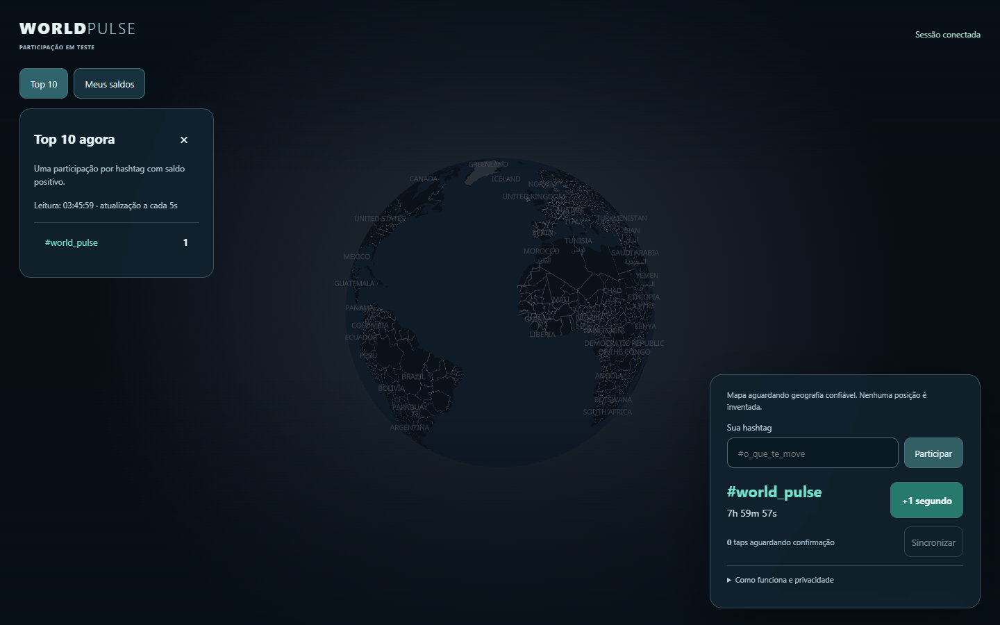
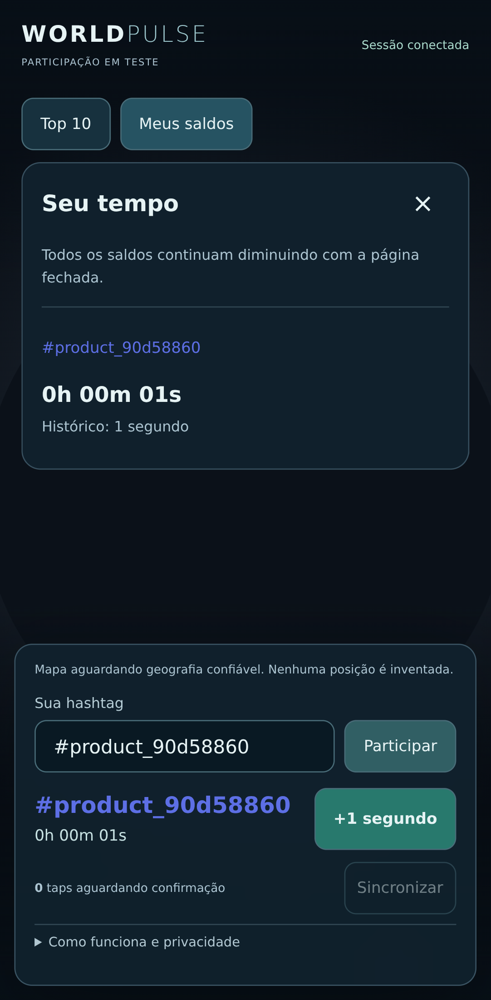

# 29 — Experiência integrada de participação

Issue #68, milestone v0.4. A experiência usa o mesmo cliente/API validados,
com criação/seleção de hashtags livres, cor persistida, taps no planeta ou botão,
fila pendente, confirmação, múltiplos saldos e ranking atual. O ranking atualiza
após confirmação e a cada 5s com aba visível; falha é indicada sem inventar zero.

## Dados e mapa

Nenhuma população sintética é passada ao globo nesta experiência. A [geografia por país](31-country-geography.md) desenha somente áreas agregadas
de várias hashtags por país, com foco opcional na selecionada, quando existem grupos
publicáveis. [Composição e busca](38-multicolor-countries.md) mantêm acesso às minorias.
Sem dados confiáveis, mantém coleção vazia e luzes decorativas desligadas.
Não converter país/IP em posição individual. A demonstração permanece padrão
enquanto a flag específica da alpha estiver desligada.

O hook mantém um cliente por montagem, sincronização limitada em background
visível, seleção entre abas, fila persistente e quarentena. Falha permite retry;
taps só saem da fila após confirmação. Rotação não transfere taps antigos. O
intervalo de envio não reinicia a cada tap: interação contínua não impede flush.

Gestos usam o reconhecedor existente: tap curto em terreno sem área de participação
adiciona +1; área de país inspeciona e não gera crédito. O botão +1 continua explícito.
Drag, wheel, pinch e cancelamento navegam. Seleção pelo ranking não soma tempo.
O contador confirmado usa snapshots/relógio monotônico, sem inventar saldo local.

## Acesso

- Local: `npm run dev` e `/?experiencePreview=1`. API real requer o harness
  PostgreSQL descartável ou ambiente deliberadamente configurado; Vite sozinho
  não fornece os handlers de participação.
- Build preview: exige `VERCEL_ENV=preview` e `WP_PREVIEW_UI=true` no build,
  além da URL opt-in. O bundler recebe apenas um boolean, não as variáveis privadas.
- Production: `WP_PREVIEW_UI` e query não habilitam a tela. Somente um build com
  `VERCEL_ENV=production` e **WP_ALPHA_RELEASE=true** a monta na raiz. Essa flag
  específica está false e não ativa a API por si só.
- Backend permanece independente: uma UI autorizada não desbloqueia a API.

## Verificação

- Testes de browser desktop/mobile com falha, retry, seleção, retorno e captura.
- Teste HTTP/PostgreSQL descartável com tap real no canvas, drag sem crédito,
  saldo/histórico após reload e verificação direta dos registros.
- Três builds estáticos testados: produção fechada, preview por opt-in e alpha
  por flag separada. Diretórios/artefatos separados evitam colisões.
- A captura de testes usa cartografia mínima, não comprova tiles/QA físico.

Ainda pendentes: verificar a fonte na borda real, preview HTTPS da Vercel com
staging e QA físico. [HTTPS privado contra Neon real](35-staging-private-https-smoke.md)
foi aprovado sem publicar e não substitui esses gates. [Leitura de saldos limitada](33-bounded-balance-view.md)
e [nomes legíveis](34-tag-label-readability.md) completam a UX atual.

## Evidências de execução — 24/10/2026

Primeira rodada completa [PostgreSQL/canvas 40054647463](https://github.com/Faysk/world-pulse/actions/runs/40054647463)
e [UI/builds 40054647474](https://github.com/Faysk/world-pulse/actions/runs/40054647474)
aprovada. Revisão posterior acrescentou aviso de fila volátil, formatter reutilizado
e teste do resultado durável do envio automático, evitando depender de um estado
transitório da fila. A fonte inclui também os spikes visuais isolados da main,
sem conectá-los a dados de pessoas nem inventar manchas.

Cartografia carregada da rede no Chromium desktop; participação é fixture de
leitura para revisão visual, não usuários públicos nem medição de backend.
Nenhuma exceção JS de página foi observada nessa captura. Isso não substitui QA
em hardware físico, nem valida a origem geográfica das participações.

Captura mobile da primeira rodada HTTP/PostgreSQL real descartável no CI;
cartografia mínima de teste, identidade/hashtag geradas no teste. O saldo pode
já ter zerado na captura porque foi creditado somente um segundo.

Rodada final: [PostgreSQL/canvas/duas sessões 40055254747](https://github.com/Faysk/world-pulse/actions/runs/40055254747)
aprovada; [build, gates e suíte desktop/mobile 40055254780](https://github.com/Faysk/world-pulse/actions/runs/40055254780)
aprovados. Spikes GPU/atlas/Mercator e painel Steam oculto também passaram na
integração. PR #70 integrado somente à branch experimental do PR #31.
A política de [publicações deliberadas](30-deliberate-deployments.md) foi
incorporada: novos pushes desta branch não solicitam preview automático.
