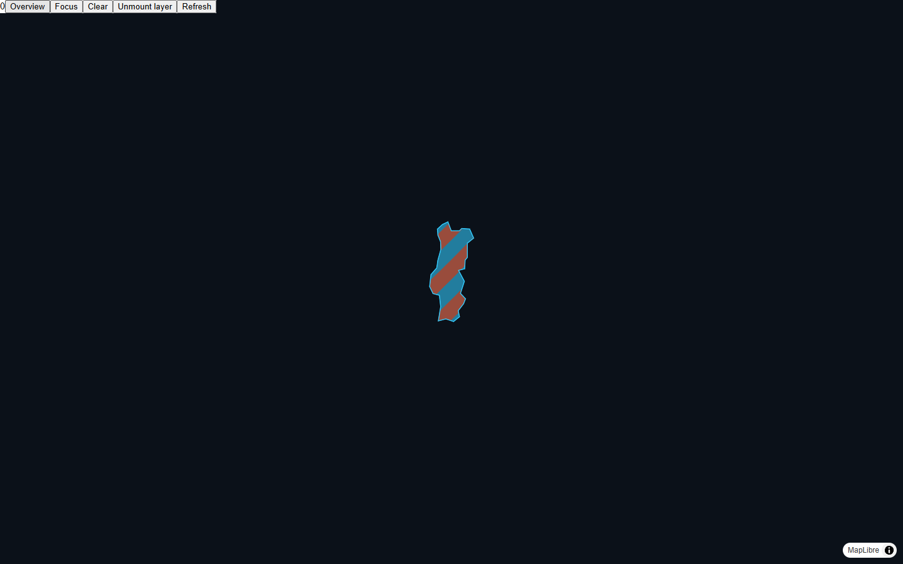

# 38 — Países multicolor e acesso às minorias

Issue #93, milestone v0.4. A experiência integrada começa com todas as hashtags
publicáveis no país; o painel Países permite focar a hashtag selecionada e voltar
à visão geral. Tocar na área inspeciona a origem e não adiciona segundos.

## Representação

Cada país usa até quatro cores de hashtags, ordenadas por participação atual,
e uma quinta cor cinza que reúne as restantes. Empates usam o ID persistido.
A textura diagonal tem 64×64 pixels e 32 faixas, distribuídas por maiores restos.
Contagens e restos são BigInt; somente quotas limitadas a 32 viram Number.
A soma das quotas é 32 e o erro por grupo é menor que uma faixa.

A área territorial não representa quantidade ou localização de pessoas. Faixas
são uma aproximação: uma minoria pode receber zero faixas, e a proporção visível
no recorte de um polígono não é uma medida exata da sua participação. A lista
mantém os números exatos e todas as hashtags, com busca e páginas de 20 itens.
O foco permite visualizar uma hashtag pequena separadamente. Cores persistidas
podem coincidir entre hashtags; nomes e números identificam cada uma.

`ZZ` e `OTHER` nunca recebem geometria. Mantêm-se consentimento, grupos menores
que cinco suprimidos e as limitações de privacidade descritas no contrato.
Alguns territórios não têm desenho no asset de 174 geometrias; continuam na lista.
A soma de sessões/hashtag não equivale a pessoas únicas: uma sessão pode manter
várias hashtags ativas.

## Recursos e verificação

Uma source GeoJSON e duas layers MapLibre permanecem estáveis entre snapshots.
Cada código desenhado usa uma imagem atualizável, reaproveitada entre visão geral
e foco. São no máximo 174 imagens; 2.850.816 bytes de pixels RGBA brutos. Esse
número não inclui atlas, mipmaps, buffers e outros custos da GPU/MapLibre e não
é uma estimativa total de VRAM. Todas as imagens são removidas no desmontar.
A textura só é atualizada quando a paleta quantizada muda; não existe objeto
por participante. Geometria e contornos só atualizam a source quando necessário.

Testes unitários cobrem vazio, origem desconhecida, 1/2/13/17/100 hashtags,
8 bilhões, 1 trilhão e contagens acima de MAX_SAFE_INTEGER, empates, minorias,
busca e paginação. Testes de navegador conferem duas cores na imagem registrada
no MapLibre, captura do desenho nativo, foco com recursos reaproveitados e
limpeza. A experiência verifica acesso à 53ª hashtag sem gerar taps.

As capturas usam cartografia mínima e Chromium emulado. Não comprovam FPS físico,
milhões de conexões, fonte de país na borda ou composição orgânica. A pesquisa
orgânica e QA físico continuam na #32; estas faixas são um fallback funcional.
A publicação e todos os gates de produção permanecem fechados.

Captura local do fixture com duas cores (4 bilhões por hashtag, sem pessoas
simuladas na experiência integrada):

Validação local: `npm run check` (133 testes, 132 aprovados e um SQL pulado),
12 testes de país/experiência e dois de paginação/foco aprovados em desktop/mobile.
