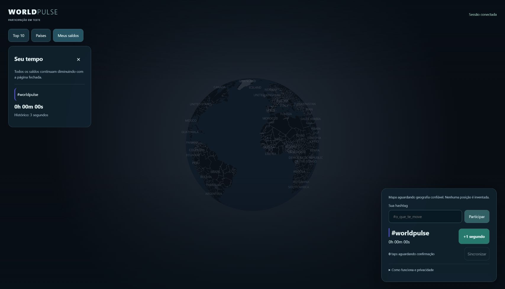

# 39 — Primeira alpha funcional em produção

**Publicado em 25/10/2026, por autorização explícita do usuário.**
[World Pulse](https://map.faysk.dev/) abre a experiência integrada na raiz, sem
query de laboratório. Este é o recibo da primeira alpha; [docs/40](40-fluid-taps-country-choice.md)
registra a atualização posterior de taps/país. Docs/36 preserva o histórico anterior.

## O que está funcionando

- Hashtags livres com ID/cor persistidos no PostgreSQL Neon de produção.
- Sessão pseudônima por cookie HttpOnly/Secure/SameSite; fila, confirmação e retry.
- +1 segundo por tap elegível; múltiplos saldos diminuem pelo tempo real, offline.
- Ranking atual por pares sessão/hashtag com saldo positivo, separado do histórico.
- Retorno ao navegador restaura seleção e histórico. Criar/selecionar sem tap não
  concede saldo. Não há população sintética na experiência pública.
- Retenção monitorada ativada pelo Actions, com execução inicial sem backlog.

No momento desta primeira publicação, a fonte geográfica **estava desativada**. Sem país confiável não há área colorida
inventada: o globo pode ficar sem manchas, mesmo com ranking funcional. R2 segue
privado para infraestrutura/probes; não recebe objetos por tap. Steam segue oculto.

## Evidências e recibo

| Etapa | Resultado |
|---|---|
| Migrações de produção | [40234524403](https://github.com/Faysk/world-pulse/actions/runs/40234524403): 0002–0006, schema e runtime restrito verificados após a correção NOINHERIT do PR #102 |
| Retenção READ ONLY | [40234613702](https://github.com/Faysk/world-pulse/actions/runs/40234613702): zero elegíveis |
| Primeira manutenção | [40234753881](https://github.com/Faysk/world-pulse/actions/runs/40234753881): zero elegíveis antes/depois; nenhum histórico removido |
| Candidato e promoção | [40234846644](https://github.com/Faysk/world-pulse/actions/runs/40234846644): candidato passou em HTML/assets/API, acesso temporário revogado e promoção confirmada. O job encerrou com 404 na primeira leitura pública durante a propagação |
| Confirmação final da produção | [40235258069](https://github.com/Faysk/world-pulse/actions/runs/40235258069): deployment/commit corretos e HTTPS HTML/JS/CSS/ranking aprovados, sem novo deploy |
| Navegador no domínio | Chrome real: sessão conectada, #worldpulse, três taps, fila zerada e histórico de três segundos restaurado após reload |

Deployment publicado: `dpl_9d1Tpy3J8B6gqz9pBpaCGtCY7CPp`.
Commit de aplicação: `fd2cb68ee00ef79319ba96bac8532fbf3032e6fc`.
O PR #104 acrescentou tentativas limitadas de leitura pública após promoção e a
operação `verify` sem publicar, evitando repetir build/promoção por propagação.
CI de infraestrutura aprovou 37 testes. Isso não substitui QA físico ou teste de
carga real.

A contribuição de verificação #worldpulse/3s permanece como dado real de QA, sem
posição geográfica atribuída. O saldo zerou pelo relógio; o histórico foi
preservado. Não foram criadas pessoas fictícias nem importados dados de staging.

## Estado dos controles

| Controle | Estado |
|---|---|
| production/WP_ALPHA_RELEASE | true |
| production/WP_API_ENABLED | true |
| production/WP_GEO_PUBLIC_ENABLED | false |
| production/WP_GEO_COUNTRY_ENABLED | false |
| production/WP_GEO_DIRECT_EDGE | false |
| production/WP_PRODUCTION_MIGRATIONS_ENABLED | false, fechado após execução |
| repository/WP_RETENTION_ENABLED | true |

Secrets continuam nos GitHub Environments e somente variáveis runtime permitidas
são sincronizadas à Vercel. Owner de migração e token operacional não vão ao app.
A role runtime tem NOINHERIT, sem memberships, sem atributos elevados ou CREATE.
Não foi necessário contratar serviço ou trocar plano.

Retenção agendada no Actions pode atrasar/falhar; acompanhar runs, ausência de
execução e backlog. A primeira execução manual aprovada não garante futuras runs.
Não há prova de backup/restore operacional nem teto financeiro para qualquer carga.

## Operação e próximos passos

- `Production infrastructure / verify`: verifica deployment atual e domínio/API
  sem build, sync, promoção ou alteração de variáveis.
- `deploy`: commit exato de main, candidato isolado, smoke, revogação e promoção.
- `migrate`: somente com API já desligada no deployment e opt-in temporário;
  nunca migração automática no deploy. Não apagar tabelas para rollback.
- Para interromper participação, mudar alpha/API/geografia para false no GitHub,
  sincronizar e reconstruir deliberadamente. Alterar vars não modifica um
  deployment já publicado. Preservar banco/histórico para investigação.

Pendências: fonte de país na borda/VPN/IPv6/rede móvel (#6), QA físico e estabilidade
mobile (#3/#12/#97), composição orgânica (#32), métricas de consumo/custo e
backup/restauração (#7). A publicação antecipada foi decisão do usuário e não
significa aceite integral de todos esses itens. #13 continua como acompanhamento.

Produção não depende da branch temporária de staging. O staging vence em
31/10/2026 01:15:25 UTC e seu token em 01/11; isso não desliga a alpha de produção.
