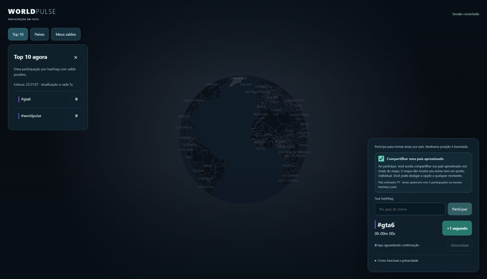

# 40 — Taps imediatos e compartilhamento de país em destaque

> Atualização de 26/10/2026: a autorização de localização foi unificada em [um único controle para ponto e resumos](43-unified-location.md). O registro abaixo preserva a implementação anterior; precisão e limites regionais permanecem.

Solicitação do usuário em 25/10/2026; issues #106 e #107. A publicação continua
via GitHub Actions; secrets não são copiadas para o browser.

## Resposta aos taps

O contador inclui uma projeção local assim que o gesto é recebido, sem esperar
lock ou HTTP. A UI informa quando inclui taps pendentes; histórico e ranking
continuam sendo valores confirmados pelo servidor. Não somar projeção a uma
fotografia que pode incluir o mesmo lote já confirmado após resposta perdida.
No reload sem prova de confirmação, lotes incertos aguardam retry do mesmo ID.

A fila v3 permanece compatível com os taps antigos, sem limpar cookies/storage.
O lock de envio serializa requests entre abas; o lock de escrita fica livre
durante o POST para adicionar taps, preservando lote selado, fingerprint e binding.
ACK remove somente o ID correspondente e nunca ressuscita fila descartada ou
atribui um lote à sessão nova. Falha de storage desfaz a adição não durável.

O limite por sessão passa de 120 para 1.200 taps/minuto, separado dos orçamentos
globais de operações. Lotes continuam com até 30 taps, três por rodada limitada.
Não é liberação de tráfego ilimitado nem prova de capacidade para milhões.
429 respeita Retry-After; falhas transitórias retomam automaticamente com backoff,
sem exigir Sincronizar. O feedback local não depende da confirmação de rede.

## País e escolha

O controle fica em destaque, junto de Participar. Para uma sessão sem escolha
anterior, começa marcado. O aviso explica que participar compartilha país
aproximado em totais, sem nome ou ponto individual; desligar continua permitido.
Apenas abrir/observar não ativa consentimento. Retomar uma fila antiga sozinha
também não muda essa preferência. Participar ou fazer novo tap registra a escolha.

Uma escolha anterior, inclusive recusa, é respeitada pelo campo geoConsentDecided,
derivado de country_consent_at já existente. Não há nova migração. Retirada pode
ser feita no controle visível, sem apagar saldo/histórico. O banco continua
inicializando consentimento false; a opção visual inicial não significa captura
silenciosa no carregamento da página.

País é estimativa por conexão, sujeita a VPN/proxy/erro. Não há GPS, cidade, IP
bruto ou posição pessoal no banco/mapa. Limiar de cinco continua e não é prova
de anonimato: comparar leituras pode permitir inferências. Não prometer
anonimato absoluto. Grupos menores são reunidos em OTHER e não têm geometria.

## Fonte e verificação

A fonte continua exigindo VERCEL=1 e gates explícitos de país/borda direta.
O preview aceita opt-in próprio de fonte e atestação de borda; não altera produção.
O smoke de fonte confirma país não desconhecido, tenta enviar país/CF/IP-forwarded
falsos e exige que a estimativa não mude. Só depois considerar ativação pública.
O domínio foi resolvido como CNAME direto para vercel-dns-017.com (DNS only).

Referência oficial: [geolocalização na Vercel](https://vercel.com/kb/guide/geo-ip-headers-geolocation-vercel-functions).
A Vercel avisa que proxy à frente prejudica essa origem. Não confundir país com
localização precisa ou identidade de pessoa física.

## Regressões

Teste de navegador prende o POST e verifica seis taps/seis segundos visíveis
antes da resposta, confirmação final sem duplicação e preferência visível com
recusa persistida. Outro teste confere 429 e reenvio automático do mesmo lote.
Node cobre resposta perdida, duas abas, lotes congelados, binding, storage e
projeção sem dobro. PostgreSQL testa até 1.200 aceitos e recusa acima da janela.

Primeira prova de fonte: [40237598249](https://github.com/Faysk/world-pulse/actions/runs/40237598249)
aprovou preview, duas sessões API, país conhecido e spoof recusado. A sessão manual
no Chrome recebeu PT após Participar; DNS do domínio aponta diretamente à Vercel.
A suíte HTTPS privada inicialmente confundiu checkbox local otimista com confirmação
de escrita: a asserção agora aguarda o valor persistido, e a UI indica salvamento.

## Publicação verificada em 25/10/2026

PR #108 integrado em `9c24577`. Todos os checks do commit `18300a1` passaram:
[visual/desktop/mobile](https://github.com/Faysk/world-pulse/actions/runs/40239595865),
[PostgreSQL e dois navegadores](https://github.com/Faysk/world-pulse/actions/runs/40239595889),
[infraestrutura](https://github.com/Faysk/world-pulse/actions/runs/40239595868) e
[privacidade](https://github.com/Faysk/world-pulse/actions/runs/40239595894).
O teste antigo do laboratório foi ajustado para aguardar ACK automático: tentar
clicar em Sincronizar depois da fila zerada era uma corrida do teste.

O [HTTPS privado com Neon real](https://github.com/Faysk/world-pulse/actions/runs/40238068928)
aprovou desktop/mobile e removeu as quatro sessões sintéticas do job. O
[preview Vercel](https://github.com/Faysk/world-pulse/actions/runs/40238375480)
aprovou duas sessões API, país conhecido e recusa de spoof de país/CF/IP-forwarded;
o acesso temporário foi revogado e as duas sessões sintéticas do job removidas.
Isso não equivale a dois navegadores automatizados no preview público.

A [publicação de produção](https://github.com/Faysk/world-pulse/actions/runs/40240376202)
aprovou probes Neon/R2, sincronização, candidato, revogação de acesso temporário,
promoção e smoke público HTML/JS/CSS/API. Deployment
`dpl_7CL7TYZYvTj8JpLLLJRxayc9eNwb`, source `9c24577`.
`WP_GEO_PUBLIC_ENABLED`, `WP_GEO_COUNTRY_ENABLED` e `WP_GEO_DIRECT_EDGE` estão
true no Environment production e foram sincronizados pelo Actions. Migrações
continuam fechadas e nenhuma nova migração foi necessária.

No Chrome público, reload preservou #gta6 e retomou a fila v3 até zero sem botão.
Três taps novos mostraram três segundos e três pendentes antes do ACK, mantendo
histórico confirmado separado. `/`, `/api/ranking` e `/api/countries` responderam
200. Novos taps/participação registram a escolha visível; apenas retomar fila antiga
não ativa consentimento. As sessões manuais de QA não são removidas pelo job;
seus saldos expiram normalmente e não foram criadas cinco sessões fictícias para
forçar área colorida em produção.

Limites continuam: país aproximado, VPN/IPv6/rede móvel e QA físico pendentes,
sem garantia de anonimato ou custo zero. Não há prova de capacidade para bilhões.
A projeção local não promete rede instantânea nem saldo confirmado antes do ACK.

Após o ACK dos três taps, o histórico passou de 380 para 383 e a fila voltou a
zero. O país estimado retornado pela borda foi PT. A captura mostra a interface
pública depois da confirmação; não é medição de FPS físico.

