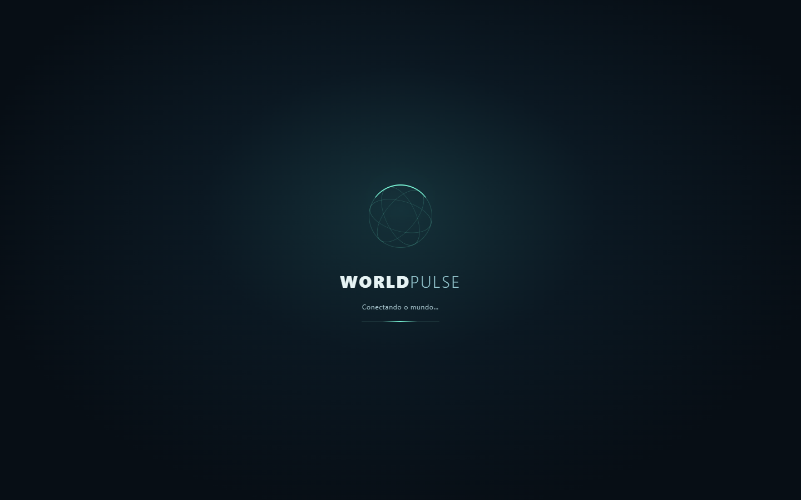
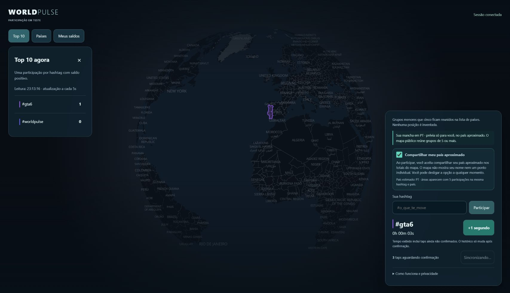

# 41 — Carregamento e prévia pessoal por país

Solicitação de 25/10/2026, issue #110.

O fallback de texto da importação lazy foi substituído por um globo CSS com órbitas,
marca e indicador indeterminado. A mesma apresentação acompanha a carga do mapa e
se dissolve quando ele fica pronto; erro de mapa libera os controles. Não há
porcentagem fictícia, imagem remota ou nova dependência. `prefers-reduced-motion`
desativa animação/transição; o status de carregamento fica fora da árvore acessível
quando concluído. Não existe espera mínima artificial.

A ausência de mancha com uma sessão não era falta de saldo: o agregado público
suprime países com menos de cinco participações na mesma hashtag. Esse limiar
permanece intacto. A UI agora desenha uma **prévia pessoal, somente no navegador**,
para o país aproximado da hashtag selecionada quando há tempo positivo e escolha
de compartilhamento confirmada. O tempo pode incluir taps locais ainda pendentes,
como já indicado na interface; histórico/ranking continuam confirmados pelo servidor.

A camada `personal-country` é separada de `live-countries`, sem inserir participante
ou país em snapshots públicos, ranking ou banco. Não publica localização individual,
nem supõe cidade/GPS ou centro do país como posição de alguém: destaca o polígono
inteiro e informa “prévia só para você”. As áreas públicas continuam acima dela.
Ela acompanha cor/seleção, some ao saldo zerar, retirada ou origem desconhecida;
respostas de geometria em trânsito são canceladas logicamente para não ressuscitar
uma prévia retirada. Source/layers são removidas no unmount, e o GeoJSON é
compartilhado com a camada pública, sem segunda transferência.

Tocar essa prévia pessoal inspeciona o país, sem adicionar tempo; passar o mouse
somente muda o cursor, sem abrir painéis. Botão +1 ou terreno sem área continuam
adicionando tempo. A prévia é da hashtag
selecionada, não um mapa de todas as participações pessoais simultâneas.

Verificação: testes de navegador conferem polígono PT visível com source pública
vazia, retirada e liberação de recursos. A experiência integrada cobre saldo
positivo, recusa e saldo zerado. O teste de carregamento retém a resposta do estilo,
confere status visível e movimento reduzido, e só libera quando o mapa fica pronto.
Isso não é prova de FPS físico ou de estimativa correta em toda rede/VPN.

## Recibo de produção

PR #111 integrado em `f63605a`. CI [40242582051](https://github.com/Faysk/world-pulse/actions/runs/40242582051)
aprovou build, gate compilado (3 testes) e navegador (59 aprovados, 1 pulado).
CI [40242582020](https://github.com/Faysk/world-pulse/actions/runs/40242582020)
aprovou PostgreSQL e dois navegadores. Testes focados locais: 24 aprovados;
os seis do renderer foram repetidos após o ajuste de inspeção e passaram.

[Deploy 40243486238](https://github.com/Faysk/world-pulse/actions/runs/40243486238)
aprovou probes, sincronização, candidato, revogação de acesso temporário, promoção
e smoke público de HTML/JS/CSS/API. Deployment `dpl_9XrMpXrhwhXh1E1TKV1giWVDLQU8`.
Sem migração ou novas credenciais/flags.

Chrome público mostrou o novo carregamento ao recarregar e restaurou #gta6/país PT.
Taps reais nessa sessão desenharam Portugal na cor roxa da hashtag, mesmo com
apenas uma participação ativa no ranking. A fila retomou automaticamente até zero;
a prévia desapareceu quando o saldo terminou. Zoom foi conferido visualmente.
A captura contém tempo provisório e a indicação correspondente; não é recibo
individual de todos os segundos nem prova de FPS físico. Nenhuma sessão extra
foi criada para ultrapassar o limiar público de cinco.

