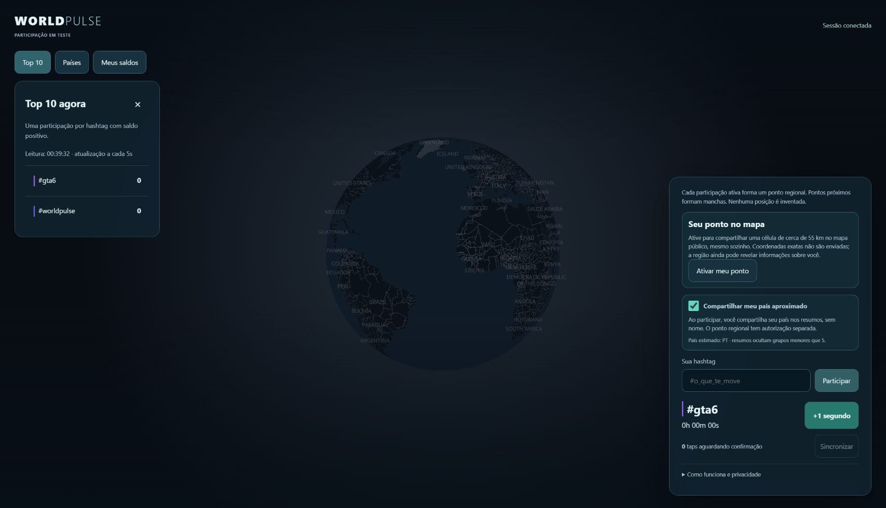

# 42 — Pontos regionais com localização aproximada do navegador

> Atualização de 26/10/2026: a autorização de localização foi unificada em [um único controle para ponto e resumos](43-unified-location.md). O registro abaixo preserva a implementação anterior; precisão e limites regionais permanecem.

Solicitação/decisão do usuário em 25/10/2026; issue #113. Substitui a prévia de
país inteiro do PR #111/documento 41: essa área não representava uma participação.

## Escolha e precisão

“​​Ativar meu ponto” explica a publicação regional e aciona a permissão de
geolocalização do navegador. Não solicita permissão ao abrir a página nem usa
consentimento antigo de país como autorização regional. Negar ou não dispor de
localização permite continuar com hashtags, taps, saldos e ranking sem ponto.

O callback transforma latitude/longitude imediatamente numa célula `r1:linha:coluna`.
A grade divide a latitude em faixas de 0,5 grau e ajusta o número de colunas pela
latitude central, aproximadamente 55 km de largura/altura fora dos extremos
polares. É uma quantização, não um raio de precisão garantido: o navegador pode
errar; bordas, polos e mudança de célula não garantem anonimato. O ponto desenhado
é o centro da célula, nunca uma posição exata nem um centro de país inventado.
Coordenadas recebidas do navegador não entram em storage, fila de taps, payload,
telemetria ou banco. O servidor recebe somente o código da célula e rejeita
coordenadas/extras no endpoint de localização. Não há watchPosition ou rastreamento
contínuo. Atualizar o ponto exige nova ação; não há histórico de deslocamentos.
A grade é fixa e versionada, sem saltos de precisão por zoom.

## Persistência e agregados

Migração aditiva 0007 cria `visitors.region_cell`, `region_shared_at`, índices de
células não nulas/expiração e um cache regional de cinco segundos. Sessões antigas
começam com região NULL. Não altera saldos, filas, ranking, cores ou histórico.
A região atual vale para as hashtags da sessão com saldo positivo; atualizar a
região move suas participações ativas, sem guardar trajetória por hashtag.
Retenção de 30 dias remove o vínculo regional junto da sessão consolidada.

`POST /api/location` requer cookie, mesma origem, orçamento e geografia habilitada;
aceita só `{cell}` válido ou null para retirar. `GET /api/regions` usa os mesmos
gates de API/geografia e retorna contagens por célula/hashtag, nunca IDs de sessão.
Uma participação positiva já pode aparecer nesse agregado regional: a decisão
é distinta do limiar de cinco do resumo por país, que permanece só na lista.
A UI informa esse fato antes de pedir permissão. Sem garantia de anonimato;
regiões esparsas, hashtags específicas e comparação temporal podem permitir
inferências. Um cliente modificado pode mentir sobre sua célula; localização do
browser não é prova de identidade ou presença física.

Retirada invalida cache dentro da mesma transação com lock compartilhado com o
rebuild. A UI rejeita respostas antigas após troca/retirada/desativação. Leituras
já recebidas por outros não podem ser apagadas. Polling/cache de 5s implica atraso
na atualização pública, inclusive expiração; não prometer instante exato.
Acima de 2.000 combinações célula/hashtag, a API falha explicitamente em vez de
truncar os totais ou fingir capacidade. Viewport/tiles/paginação ficam pendentes.

## Visual

O app principal não desenha polígonos de país. Uma célula/hashtag é um ponto
pequeno com halo; múltiplas participações na célula aumentam o brilho/tamanho de
forma limitada, sem peso pelos segundos e sem objeto por pessoa. Halos próximos
se sobrepõem; não é ainda um compositor orgânico multicolor sem oclusão (#32).
Pontos de diferentes hashtags na mesma célula podem se sobrepor; ranking e foco
continuam necessários. Não prometer solução visual para bilhões.

Pontos próprios podem ser projetados imediatamente a partir do tempo pendente,
com o aviso existente; substituem uma linha pública correspondente sem somar
uma participação extra. Histórico/ranking continuam confirmados pelo servidor.
Tocar um ponto seleciona a hashtag e não adiciona tempo; +1 ou terreno vazio
continuam adicionando. As camadas antigas ficam como laboratórios isolados.

## Publicação

A migração passa primeiro pelo PostgreSQL descartável e staging Neon. Produção
usa o Actions: publicar temporariamente com API desativada, executar a migração
revisada, fechar o gate de migração e publicar novamente com API ativa. Credencial
owner nunca vai ao app. Sem novas secrets, serviço de localização externo ou GPS
preciso persistido. Backups/restore, VPN/redes móveis/precisão e QA físico continuam
pendentes e não são comprovados pelos testes de navegador com coordenadas de fixture.

O resumo de países só faz polling enquanto seu painel está aberto. O mapa regional
faz uma leitura a cada 5s, além do ranking atual. Com o orçamento conservador de
600 leituras/minuto, 24 leituras/minuto por navegador visível já limitam a alpha a
cerca de 25 navegadores antes de considerar mutações/retorno; abrir países adiciona
12 leituras/minuto. Isso é orçamento interno, não capacidade medida da Vercel/Neon.
Cache/CDN, snapshots combinados e medição de custo continuam necessários (#7).

## Recibos de 26/10/2026

- PR #114 integrou pontos/migração; PR #115 adicionou manutenção explícita após o
  sync inicialmente recusar alpha com API false. Essa primeira tentativa não mudou
  a Vercel nem migrou dados. O opt-in WP_MAINTENANCE só funciona com API e todos
  os gates geográficos false; não é enviado ao runtime do app.
- CI [40248412376](https://github.com/Faysk/world-pulse/actions/runs/40248412376):
  32 testes desktop e 31 mobile aprovados, 1 mobile pulado, mais 3 de build/gates.
  Os projetos agora têm jobs/artifacts separados e o mesmo limite de 12 minutos;
  a asserção antiga do texto de país foi atualizada, sem retirar o teste de taps.
- CI [40248412159](https://github.com/Faysk/world-pulse/actions/runs/40248412159):
  PostgreSQL e dois navegadores aprovados. Infra: 39 testes aprovados com manutenção
  ([40249256902](https://github.com/Faysk/world-pulse/actions/runs/40249256902)).
- Staging migrou em [40246521868](https://github.com/Faysk/world-pulse/actions/runs/40246521868).
  HTTPS/Neon real [40247107596](https://github.com/Faysk/world-pulse/actions/runs/40247107596):
  4 testes desktop/mobile aprovados, 6 sessões sintéticas limpas. A primeira tentativa
  do teste regional falhou porque seu helper descartava regionCell; foi corrigido.
- Preview Vercel [40247841155](https://github.com/Faysk/world-pulse/actions/runs/40247841155)
  aprovou duas sessões na mesma célula (2 → 1 → 0 com retiradas), cookies, retorno,
  retry e país/spoof. Deployment dpl_HMhu79maeFUoKCYqEi7WDGEKxqBz; acesso temporário
  revogado e 2 sessões sintéticas limpas. Uma tentativa concorrente anterior recebeu
  503; o smoke passou a repetir somente leituras transitórias, sem repetir escritas.
- Manutenção pública [40249355329](https://github.com/Faysk/world-pulse/actions/runs/40249355329)
  foi promovida e a API pública respondeu 503 antes de executar SQL.
- Migração de produção [40249564901](https://github.com/Faysk/world-pulse/actions/runs/40249564901):
  0007 aplicada, schema e runtime conferidos; NOINHERIT, sem memberships/DDL/privilégios
  elevados. Owner encerrou antes da verificação runtime. Nenhum saldo foi reescrito.
- Reativação [40249714364](https://github.com/Faysk/world-pulse/actions/runs/40249714364)
  aprovada: deployment dpl_HkgnVcyGXEU1JaRUu8wxhSzwqea5, source f42e7c8.
  API/alpha/geografia true; WP_MAINTENANCE=false e WP_PRODUCTION_MIGRATIONS_ENABLED=false.
  Ranking, regiões e países públicos responderam 200; HTML/assets passaram antes e
  depois da promoção. Futuras publicações continuam manuais pelo GitHub Actions.

Chrome público restaurou a sessão/#gta6 e exibiu Ativar meu ponto, sem polígono de
país. Nenhuma permissão antiga foi convertida em autorização regional. Na tentativa
manual deste dispositivo, o navegador retornou Localização indisponível; nenhuma
célula foi enviada/publicada por essa tentativa. A janela estava minimizada e a
ferramenta não expôs o pedido de permissão; isso não identifica a causa do erro.
Precisão/permissão em hardware real continuam pendentes em #6/#12. As provas
regionais acima usam coordenadas de fixture apenas no staging, não um ponto
fictício em produção. O usuário precisa ativar e permitir numa janela/navegador
que consiga fornecer localização; negar continua preservando taps/ranking.

O orçamento diário também é material: 24 leituras/minuto contínuas equivalem a
34.560 leituras/dia por navegador, antes de mutações. O teto global atual de
50.000 requests/dia não sustenta dois navegadores ininterruptos nesse ritmo.
Cache SQL não remove cobrança de request nem esse limite. Snapshots combinados,
cache/CDN e polling adaptativo precisam ser medidos antes de ampliar a alpha (#7).
Saldos mais curtos que o intervalo de polling podem terminar entre leituras
públicas; o feedback próprio provisório não significa transmissão global instantânea.
