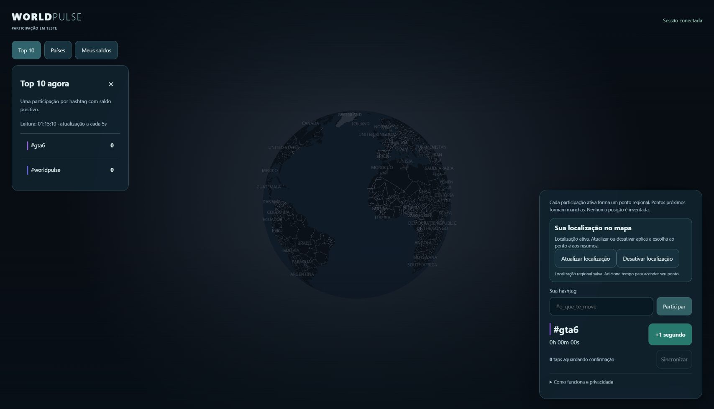

# 43 — Uma autorização de localização

Correção solicitada em 26/10/2026, issue #117. A interface tinha um botão para
região e um checkbox separado para país; o modelo duplicava a decisão e ocupava
espaço sem ajudar a participação. Agora existe um único bloco:

- Compartilhar localização pede permissão ao navegador, arredonda antes do envio e
  autoriza o ponto regional e o país estimado nos resumos.
- Atualizar localização substitui a célula atual e renova a mesma escolha.
- Desativar localização remove célula e país na mesma transação, invalida ambos os
  caches e preserva saldos/histórico. Também funciona para quem só tinha a escolha
  antiga de país e mesmo com as leituras geográficas desativadas (API ativa).

Selecionar hashtag, tocar, sincronizar fila, abrir a página ou retornar não ativa
compartilhamento automaticamente. Recusar a permissão não introduz uma nova coleta.
Sessões antigas não ganham permissão regional silenciosamente: escolhas anteriores
continuam até uma ação explícita; o controle informa compartilhamento antigo de
país e permite removê-lo. Uma nova ativação/atualização aplica a escolha aos dois.

`POST /api/location` é a operação unificada e retorna a escolha/código de país junto
da célula. O país continua estimado pela conexão confiável e pode divergir da região
do navegador (VPN/erro); não inferimos país preciso a partir do centro da célula.
A API antiga de consentimento de país permanece para compatibilidade, fora do fluxo
novo. O lock segue país → região → sessão, na mesma ordem da limpeza de QA.

Não há nova migração, nova secret, serviço ou alteração de precisão. Os limites,
riscos e orçamento de docs/42 continuam; a autorização regional pública pode
mostrar uma participação, enquanto nomes nos resumos por país continuam exigindo
cinco. A checkbox de país e o opt-in automático do fluxo de taps foram removidos.

Verificação cobre ausência da checkbox, retirada de preferências antigas, taps sem
novo consentimento, ativação/retirada unificada e persistência após reload; SQL
confere ambos os campos alterados atomicamente e permissões continuam restritas.

## Publicação e evidências — 26/10/2026

PR #118 integrado em 6531e39. CI [40252425678](https://github.com/Faysk/world-pulse/actions/runs/40252425678)
aprovou 32 testes desktop, 31 mobile e 3 de gates/build; 1 caso mobile permanece
pulado. PostgreSQL e dois navegadores passaram em
[40252425622](https://github.com/Faysk/world-pulse/actions/runs/40252425622).
Build local/136 testes e infraestrutura/39 testes aprovados; SQL local é o único
caso pulado quando não há PostgreSQL descartável configurado.

[HTTPS privado com Neon](https://github.com/Faysk/world-pulse/actions/runs/40252429397)
aprovou 4 testes desktop/mobile e limpou 6 sessões sintéticas. A
[prévia Vercel](https://github.com/Faysk/world-pulse/actions/runs/40252840175)
confirmou geoConsent true ao compartilhar célula e false ao retirar, além de
contagens/retirada; acesso temporário revogado e 2 sessões sintéticas limpas.

[Produção 40253038393](https://github.com/Faysk/world-pulse/actions/runs/40253038393)
aprovou candidato, HTML/JS/CSS/API, revogação de acesso temporário e promoção.
Deployment dpl_D8KeX1pbK8XHaYvJdaxm1TBN2ykX, source 6531e39. Sem migração ou pausa.
Raiz, ranking, regiões e países públicos responderam 200 após a publicação.

Chrome público mostrou um único bloco, sem checkbox de país, preservando sessão,
#gta6 e fila zerada. A sessão já tinha região salva; a conferência de UI não pediu
nova localização, não expôs coordenadas e não alterou essa preferência. A captura
registra o estado de atualização/desativação, não uma prova de precisão física.

