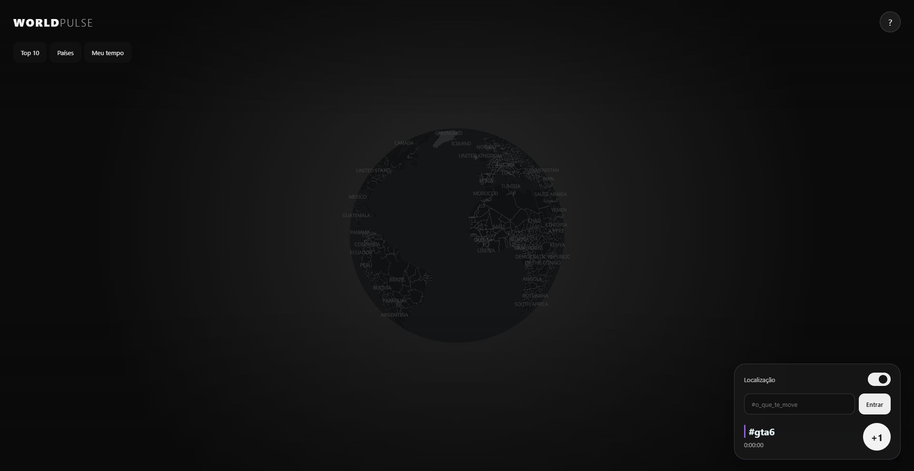

# Interface pública e idioma

Issue: #120. Substitui os controles visuais descritos em 43-unified-location.md; a autorização e o backend continuam os mesmos.

## Experiência

- O globo fica livre na abertura; Top 10, países e saldos abrem sob demanda.
- Uma chave **Localização / Location / Ubicación** liga ou retira o compartilhamento de ponto e país. Estado confirmado pelo servidor; fica bloqueada durante a solicitação. Falha ou recusa não liga a chave.
- O botão **Entrar / Enter** seleciona a hashtag. O botão circular **+1** mantém o feedback imediato e a fila durável existente.
- Não há botão de sincronização, contagem de fila, selo de teste ou status de sessão em condições normais. Tentativas automáticas, backoff e idempotência continuam. Falhas que exigem ação (armazenamento, sessão isolada, conexão ou localização) continuam visíveis.
- O **?** no alto à direita abre uma caixa modal acessível com uso, ranking, localização, retenção, sincronização e GitHub. Escape fecha; o foco retorna ao botão. Sem permissões novas ou mudança na precisão.
- Interface, carregamento e mapa base em tons neutros. As cores das hashtags continuam para distinguir os pontos.

## Idioma

Dicionários completos da interface em inglês, português e espanhol em `src/liveCopy.ts`. País conhecido da preferência da sessão escolhe português ou espanhol conforme o mapeamento explícito. Outros países, `ZZ` ou falta de localização usam inglês. Não deduzimos idioma do nome da hashtag, coordenadas ou do navegador. O país vem da estimativa de conexão já existente e pode ser errado com VPN; não é geocodificação reversa.

A chave desligada deixa o país `ZZ`, voltando ao inglês em modo automático. Na ajuda é possível escolher um dos três idiomas para a visita atual. `html.lang` e formatos numéricos acompanham a escolha. Não afirmamos cobrir todos os idiomas ou resolver países multilíngues; ampliar traduções exige outro dicionário revisado.

## Verificação

Testes de navegador exercitam clique com resposta retida, repetição idempotente após 429, restauração, retirada de consentimento legado, geografia desativada, negação da localização, envio só da célula e ativação/retirada. O novo cenário verifica inglês sem localização, português após país PT, retorno ao inglês, espanhol manual, ajuda por teclado e altura compacta em desktop/mobile.

Testes reais de participação e staging passaram a observar resultado confirmado e sincronização automática, sem depender do botão removido. Nenhuma migração, secret ou alteração em infraestrutura é necessária.

## Publicação em 26/10/2026

PR #121 integrado em `229a4df`. Produção: workflow [40322183129](https://github.com/Faysk/world-pulse/actions/runs/40322183129), deployment `dpl_79VpR3FgTeDhKQa93zzT4C8jshqQ`. Candidato testado antes da promoção, acesso temporário revogado e HTTPS/assets públicos aprovados. Leituras manuais de `/`, `/api/ranking`, `/api/regions` e `/api/countries`: HTTP 200. Chrome real confirmou chave única ativa, Entrar, +1, painéis fechados, idioma português da sessão existente e ajuda/GitHub acessíveis. A verificação não criou taps nem alterou localização.

Evidências:

- `npm run check`: 137 aprovados, um SQL local ignorado; build aprovado.
- Navegador local: 22 cenários desktop/mobile aprovados; nova captura em ambos aprovada após aguardar o mapa. Gates compilados: três aprovados.
- CI visual [40319919760](https://github.com/Faysk/world-pulse/actions/runs/40319919760), commit `56e0a10`: desktop 33 aprovados, mobile 31 aprovados e um ignorado. Código da aplicação, dependências e build idênticos ao commit final `84a671a`; a diferença é apenas a correção de duas expectativas no teste com banco.
- CI final de participação [40320791684](https://github.com/Faysk/world-pulse/actions/runs/40320791684): transações PostgreSQL e 12 fluxos de navegador aprovados. Repetição visual [40320791837](https://github.com/Faysk/world-pulse/actions/runs/40320791837): build, gates e mobile aprovados; desktop cancelado após permanecer na instalação do Chromium, sem iniciar testes. O desktop já aprovado acima continua sendo a evidência dessa mesma aplicação. Não se registra esse cancelamento como aprovação.
- Neon staging real/HTTPS [40319319745](https://github.com/Faysk/world-pulse/actions/runs/40319319745): quatro testes aprovados e seis sessões sintéticas removidas.
- Preview [40319805387](https://github.com/Faysk/world-pulse/actions/runs/40319805387), deployment `dpl_7wm4tnVg4s7gnt6NJBb4LocqC1yH`: assets e API aprovados; duas sessões, saldo, retry e consentimento verificados; acesso temporário revogado e duas sessões sintéticas removidas.

