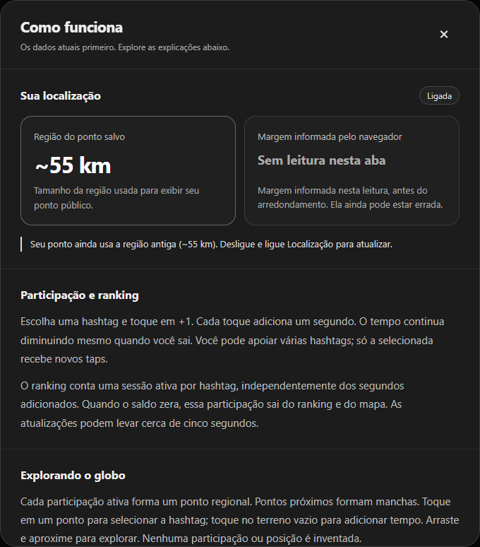

# Ajuda organizada e valores variáveis em destaque

Issue #132. A tela aberta pelo **?** passou a separar os dados atuais das explicações gerais.

## Dados atuais

No topo, dois cartões mostram a região do ponto salvo e a margem informada pelo navegador. Valores reais recebem números maiores, alto contraste e algarismos tabulares. As legendas explicam a diferença entre os dois conceitos. Ausência de leitura aparece como **Sem leitura nesta aba**, sem inventar zero ou margem padrão. Sem ponto salvo aparece explicitamente. O estado ligado/desligado, carregamento e indisponibilidade também são apresentados sem confundir dados desconhecidos com desligamento.

O aviso da região antiga continua contextual a 55 km. Nenhuma nova leitura ou escrita de localização ocorre ao abrir a ajuda. A margem continua temporária na memória da aba.

## Leitura

Seções por assunto: participação e ranking, exploração do globo e localização/privacidade. Detalhes de provedor/país e sessão/sincronização são recolhíveis nativos, operáveis por teclado. Idioma e GitHub ficam no rodapé. Conteúdo reorganizado em EN/PT/ES, sem remover as regras de contagem, expiração, retirada, retenção ou limites de precisão.

Texto principal de 15 px com maior entrelinha; títulos e divisores dão hierarquia. Cabeçalho e fechar permanecem visíveis ao rolar. Cartões ficam lado a lado no desktop e empilhados no celular. A tela principal e os controles de participação continuam iguais.

## Verificação

`npm run check`: 138 aprovados, um SQL local ignorado, build aprovado. Seis cenários relevantes de navegador desktop/mobile aprovados, incluindo idioma, Escape/retorno de foco, dados legados, qualidade da leitura, ausência de medição, tipografia dos valores, cabeçalho fixo e ausência de rolagem horizontal. As imagens abaixo usam dados sintéticos do teste, não uma nova leitura da posição do usuário.

[Captura da ajuda no celular](assets/readable-help-mobile-2026-10-26.png)
